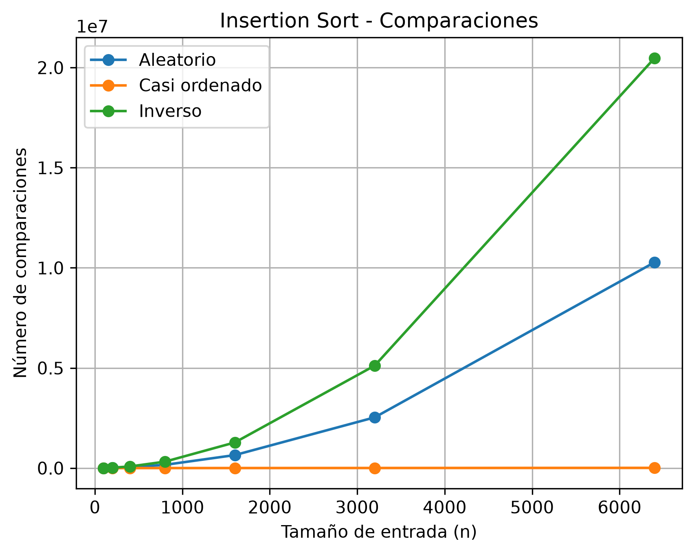
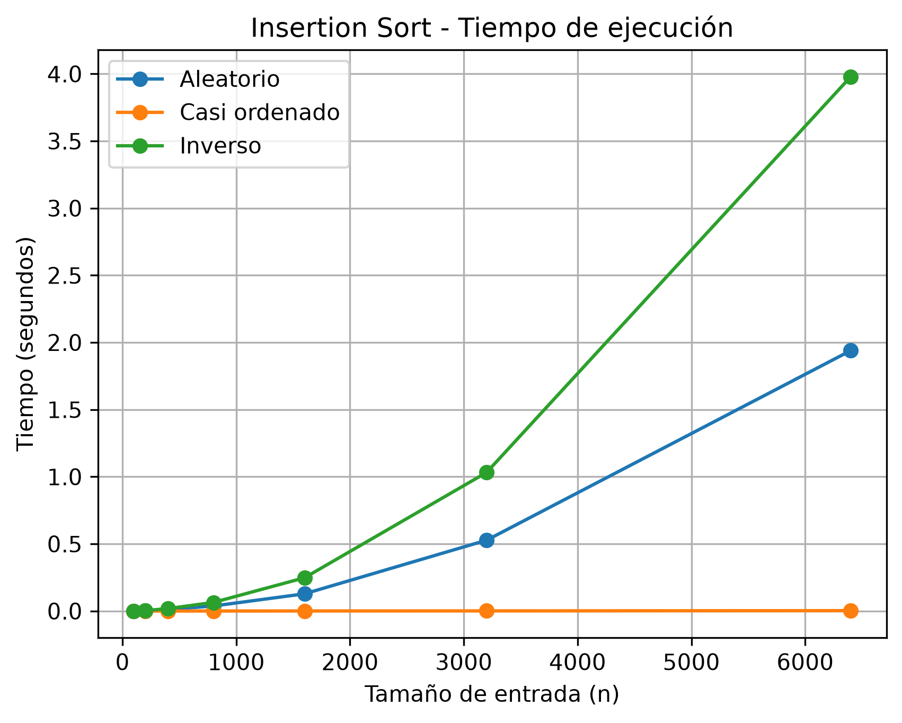
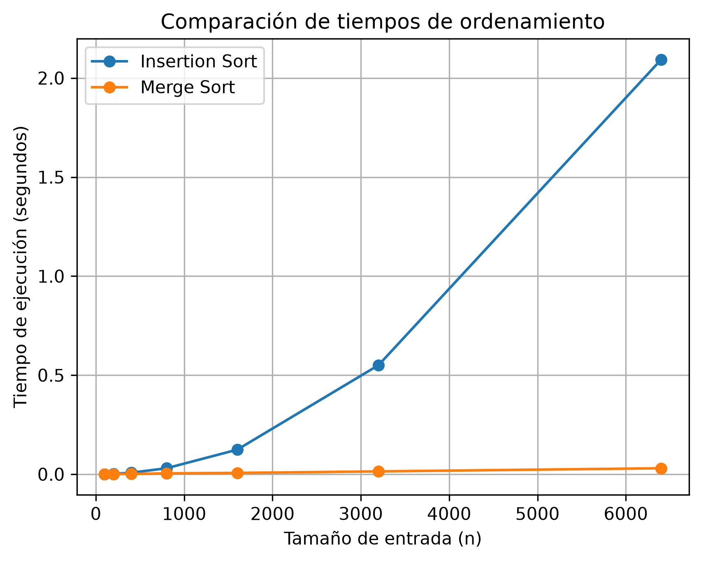

# Laboratorio evaluativo 01 — Fundamentos, complejidad y recurrencias

## Januar Stiwar Martinez Palacios.

## Instrucciones para reproducir el experimento

Los siguientes comandos deben ejecutarse desde la carpeta del laboratorio:

```powershell
cd laboratorios/lab1-fundamentos-complejidad-recurrencias
python -m venv .venv
.\.venv\Scripts\Activate.ps1
pip install matplotlib

Ejecutar parte 3
python parte3_casos.py

Ejecutar parte 4
python parte4_complejidad.py
```

## Parte 1 — Analizar el algoritmo antes de comprar hardware

La Secretaría está por firmar la compra de un servidor del doble de velocidad para que el proceso de Tamiza quepa en la ventana de cuatro horas.

### ¿Por qué debe analizarse primero el algoritmo, si el que está en producción lleva ocho años entregando el resultado correcto?

Un algoritmo funciona correctamente cuando cumple con la finalidad para la que fue planteado, pero también debe ser eficiente cuando existe una restricción de tiempo. En el caso de Tamiza, el algoritmo entrega el resultado correcto, pero no cumple con la ventana de cuatro horas.

Duplicar la velocidad del servidor no necesariamente soluciona el problema, porque esto solamente aumenta la velocidad de ejecución del equipo, mientras que el tiempo que necesita el algoritmo puede crecer mucho más rápido cuando aumenta la cantidad de datos. Por ejemplo, si un algoritmo tiene un crecimiento de O(n²), duplicar la cantidad de datos puede hacer que el trabajo sea aproximadamente cuatro veces mayor. Por esta razón, antes de comprar un servidor más rápido es necesario analizar la complejidad del algoritmo.

**Otro ejemplo** es un sistema de una empresa que procesa las llamadas realizadas por sus clientes durante el día. El sistema puede recibir más de 2.000.000 de registros y debe procesarlos dentro de una ventana de 8 horas. Aunque el algoritmo entregue correctamente el resultado, si tarda más de 8 horas se rompe la restricción del sistema y la información no estaría disponible cuando se necesita. En este caso, aumentar solamente la velocidad del servidor podría no ser suficiente si el crecimiento del algoritmo es demasiado alto.

## Parte 2 — Responsabilidad ambiental y ética de la implementación

### Como responsable técnico de Tamiza, ¿qué responsabilidad ambiental y ética asume al decidir qué algoritmo de ordenamiento se ejecuta cada madrugada sobre los datos de 1.200.000 pacientes?

Debido a que se tiene un servidor ejecutando el proceso, esto se traduce en consumo de energía. El hecho de que el proceso esté programado para ejecutarse todas las madrugadas hace que este consumo se repita diariamente. Si el algoritmo tarda más de lo necesario, durante años se estaría utilizando más tiempo de procesamiento y, por lo tanto, más energía para realizar la misma tarea.

La lentitud del programa afecta al centro de contacto, ya que al iniciar la jornada pueden no contar con la lista completa para realizar las llamadas. En este caso, el equipo de desarrollo debe asumir el costo del error porque una implementación que no cumple la ventana establecida afecta el funcionamiento de otro equipo.

También se ven afectados los pacientes, debido a que el orden de la lista determina a quién se debe llamar primero según su índice de riesgo. Un error en el ordenamiento podría provocar que un paciente con mayor riesgo quede después de otros pacientes y no sea contactado a tiempo. Por esta razón, la responsabilidad técnica no consiste solamente en que el algoritmo produzca una lista ordenada, sino en garantizar que el orden sea correcto y que el proceso termine dentro del tiempo requerido.

Es importante que el ordenamiento sea adecuado porque de este resultado depende el orden en que se realizan las llamadas. Al tratarse de pacientes clasificados por índice de riesgo, un error de orden puede tener consecuencias sobre la atención que recibe una persona.

## Parte 3 — Peor caso, mejor caso y caso promedio, demostrados en Python

### 3.1 — Explicación

Para analizar los casos se consideran todas las posibles listas de entrada que tienen el mismo tamaño `n`. El mejor caso corresponde a la entrada que requiere menos trabajo, el peor caso corresponde a la que requiere más trabajo y el caso promedio representa el comportamiento esperado sobre entradas sin un orden particular.

- El **mejor caso** se da cuando los `n` registros ya vienen ordenados por índice de riesgo de mayor a menor. En este caso, Insertion Sort solamente necesita recorrer la lista realizando una comparación entre elementos por cada posición.

- El **caso promedio** se considera cuando los registros llegan en un orden aleatorio. No existe una posición previa que permita asumir que los elementos ya están ordenados, por lo que el algoritmo realiza una cantidad intermedia de comparaciones y desplazamientos.

- El **peor caso** se da cuando los registros vienen ordenados de menor a mayor riesgo. En este caso, cada elemento debe desplazarse hacia la posición correspondiente para conseguir el orden de mayor a menor.

Para decidir si el algoritmo entra en producción se debe considerar el peor caso, porque representa la mayor cantidad de trabajo que puede tener que realizar el algoritmo para una entrada de tamaño `n`.

La predicción para los escenarios de Tamiza es:

- **A — Aleatorio:** caso promedio.
- **B — Casi ordenado:** se aproxima al mejor caso.
- **C — Orden inverso:** peor caso.

### 3.2 — Demostración experimental

[código de la Parte 3](parte3_casos.py)

Los generadores utilizados para construir los escenarios de prueba
se encuentran en [datos.py](datos.py), mientras que los algoritmos
de ordenamiento se encuentran en [algoritmos.py](algoritmos.py).

#### Comparaciones



En la gráfica de comparaciones se observa que para `n = 6400`, el
escenario C — orden inverso presenta aproximadamente **20476800 comparaciones**,
mientras que el escenario B — casi ordenado presenta aproximadamente
**10277 comparaciones** y el escenario A — aleatorio aproximadamente
**10276753 comparaciones**.

Esto muestra que el escenario C requiere más trabajo y corresponde al
peor caso, mientras que el escenario B requiere menos comparaciones y
se aproxima al mejor caso. El escenario A presenta un comportamiento
intermedio y representa el caso promedio.

#### Tiempo de ejecución



En la medición de `n = 6400`, el escenario C tardó **4.35304790 segundos**,
el escenario A **2.08809030 segundos** y el escenario B **0.00355680 segundos**.

Los resultados coinciden con la predicción realizada antes del
experimento.

## Parte 4 — Complejidad de merge sort e insertion sort: cálculo y validación

### 4.1 — Cálculo teórico

#### Planteamiento de la recurrencia de Merge Sort y resolución por método de sustitución

La recurrencia de Merge Sort es:

$$
T(n)=2T\left(\frac{n}{2}\right)+cn
$$

Cada término representa una parte del algoritmo:

- `2T(n/2)` representa las **dos llamadas recursivas** que realiza Merge Sort. Cada una trabaja con aproximadamente la mitad de los datos, es decir, `n/2`.
- `cn` representa el costo de la etapa de **mezcla (merge)**. Para combinar las dos mitades es necesario recorrer los elementos de ambas listas, por lo que esta operación tiene un costo lineal.
- El factor `c` representa una constante asociada al trabajo realizado al combinar los elementos.

El caso base ocurre cuando la lista tiene un solo elemento o está vacía:

$$
T(1)=d
$$

donde `d` es una constante, porque una lista de uno o cero elementos ya está ordenada y no necesita dividirse nuevamente.

#### Método de sustitución

Partimos de:

$$
T(n)=2T\left(\frac{n}{2}\right)+cn
$$

La hipótesis de sustitución es:

$$
T(n)\leq cn\log_2 n
$$

Para `n/2`:

$$
T\left(\frac{n}{2}\right)
\leq
c\frac{n}{2}\log_2\left(\frac{n}{2}\right)
$$

Sustituimos esta hipótesis en la recurrencia:

$$
T(n)
\leq
2\left[
c\frac{n}{2}\log_2\left(\frac{n}{2}\right)
\right]+cn
$$

Simplificando:

$$
T(n)
\leq
cn\log_2\left(\frac{n}{2}\right)+cn
$$

Como:

$$
\log_2\left(\frac{n}{2}\right)
=
\log_2 n-\log_2 2
$$

y:

$$
\log_2 2=1
$$

entonces:

$$
T(n)
\leq
cn(\log_2 n-1)+cn
$$

$$
T(n)
\leq
cn\log_2 n-cn+cn
$$

Por lo tanto:

$$
T(n)\leq cn\log_2 n
$$

La hipótesis se mantiene y por lo tanto:

$$
\boxed{T(n)=O(n\log n)}
$$

---

### Cota manual de Insertion Sort

El código de Insertion Sort tiene un ciclo externo:

```python
for i in range(1, n):
```
Este ciclo se ejecuta n - 1 veces.

En cada iteración se asignan:
```python
clave = datos[i]
j = i - 1
```
por lo que estas instrucciones también se ejecutan n - 1 veces.

El ciclo:
```python
while j >= 0:
```
depende de la posición que tenga el elemento que se está insertando.
Definimos t_i como la cantidad de veces que se ejecuta el cuerpo del while para la posición i.

La comparación entre elementos es:
```python
if datos[j] >= clave:
```
y es la comparación que se cuenta en el experimento.

En el peor caso, los datos vienen en orden inverso al que necesita Tamiza. Para ordenar de mayor a menor, la lista llega de menor a mayor. En este caso, para cada posición i, el elemento debe desplazarse hasta el inicio, por lo que:
$$
t_i = i
$$

Por lo tanto:

$$
\sum_{i=1}^{n-1} i = \frac{n(n-1)}{2}
$$

El resto de instrucciones del algoritmo se ejecutan una cantidad lineal de veces o dependen de esta suma.

Por eso podemos expresar el costo como:

$$
T(n) = C_1n + C_2(n-1) + C_3(n-1) + C_4 \sum_{i=1}^{n-1} (t_i + 1) + C_5 \sum_{i=1}^{n-1} t_i + C_6 \sum_{i=1}^{n-1} t_i + C_7(n-1)
$$

Sustituyendo:

$$
T(n) = C_1n + (C_2 + C_3 + C_4 + C_7)(n-1) + (C_4 + C_5 + C_6)\frac{n^2 - n}{2}
$$

El término dominante es `n²`, por lo que:

$$
\boxed{T(n) = O(n^2)}
$$

---

### Complejidad esperada de cada algoritmo

| Algoritmo | Mejor caso | Caso promedio | Peor caso |
|---|---|---|---|
| **Insertion Sort** | $O(n)$ | $O(n^2)$ | $O(n^2)$ |
| **Merge Sort** | $O(n\log n)$ | $O(n\log n)$ | $O(n\log n)$ |

### 4.2 — Validación experimental

[código de la Parte 4](parte4_complejidad.py)

Para esta parte se utilizan los algoritmos definidos en
[algoritmos.py](algoritmos.py) y los datos generados mediante
[datos.py](datos.py).

#### Comparación de tiempos de Insertion Sort y Merge Sort



En la gráfica se observa que Merge Sort presenta mejores tiempos en
todos los tamaños medidos. Para `n = 100`, Insertion Sort tarda
0.00046760 segundos y Merge Sort 0.00037570 segundos. La diferencia
aumenta al crecer el tamaño de entrada.

Para `n = 6400`, Insertion Sort tarda 2.14657220 segundos, mientras
que Merge Sort tarda 0.03705530 segundos.

El resultado coincide con las complejidades calculadas anteriormente:
Insertion Sort tiene una complejidad promedio de $O(n^2)$, mientras que
Merge Sort tiene una complejidad de $O(n\log n)$.

En los tamaños pequeños la diferencia es menor. Por ejemplo, con
100 elementos los tiempos son cercanos, aunque Merge Sort sigue siendo
más rápido en esta medición. A medida que aumenta `n`, la diferencia
entre las curvas se hace mucho mayor, lo que permite observar con más
claridad el efecto de las diferentes complejidades.

### 4.3 — Concepto técnico a la Secretaría de Salud

Para Tamiza se recomienda utilizar Merge Sort como único algoritmo de ordenamiento, debido a que el canal de entrada puede cambiar sin aviso entre registros aleatorios, casi ordenados u ordenados de forma inversa. El criterio utilizado para resolver este compromiso es priorizar un comportamiento más consistente frente a diferentes distribuciones de entrada y evitar el mantenimiento de tres implementaciones especializadas.

Esta decisión está respaldada por las mediciones realizadas. En la prueba con 6.400 registros sobre el escenario A, Insertion Sort presentó un tiempo de 2,14657220 segundos, mientras que Merge Sort presentó 0,03705530 segundos, como se observa en la gráfica `parte4_tiempo.png`. En esta medición, Insertion Sort tardó aproximadamente 58 veces más que Merge Sort.

Para estimar el comportamiento con 1.200.000 registros se utiliza como referencia la medición de 6.400 registros. Para Insertion Sort, la cantidad de datos aumenta 187,5 veces. Considerando su crecimiento cuadrático:

$$
(1.200.000/6.400)^2=35.156,25
$$

Al aplicar este factor al tiempo medido de 2,14657220 segundos, se obtiene una estimación de aproximadamente 75.465 segundos, es decir, cerca de 21 horas. Esto supera ampliamente la ventana de cuatro horas.

Para Merge Sort se considera el crecimiento $n\log n$. La extrapolación desde 6.400 hasta 1.200.000 registros da un factor aproximado de 299,5. Aplicando este factor al tiempo medido de 0,03705530 segundos se obtiene una estimación de aproximadamente 11,10 segundos.

Estos valores son estimaciones por extrapolación y no mediciones directas con 1.200.000 registros. La estimación supone que las condiciones de ejecución y el comportamiento de los algoritmos se mantienen comparables.

Respecto a la propuesta de comprar un servidor del doble de velocidad, no considero que sea la solución principal. Tomando como referencia la medición de 6.400 registros, Insertion Sort tardó 2,14657220 segundos. Incluso suponiendo idealmente que duplicar la velocidad del servidor reduzca el tiempo a la mitad, el algoritmo seguiría presentando el mismo crecimiento cuadrático y la extrapolación a 1.200.000 registros sería de aproximadamente 10,5 horas, todavía por encima de las cuatro horas requeridas. Por esto, es preferible mejorar el algoritmo antes que depender únicamente de hardware más rápido.

También se debe considerar la memoria adicional de Merge Sort, ya que necesita listas temporales durante la división y combinación. Sin embargo, este costo puede ser aceptable frente a la diferencia de tiempo observada. Además, mantener una sola implementación reduce el costo de mantenimiento y evita depender de que el escenario B continúe siendo casi ordenado. Si el flujo de reproceso cambia, Merge Sort mantiene su comportamiento de $O(n\log n)$ sin necesitar otra implementación.

