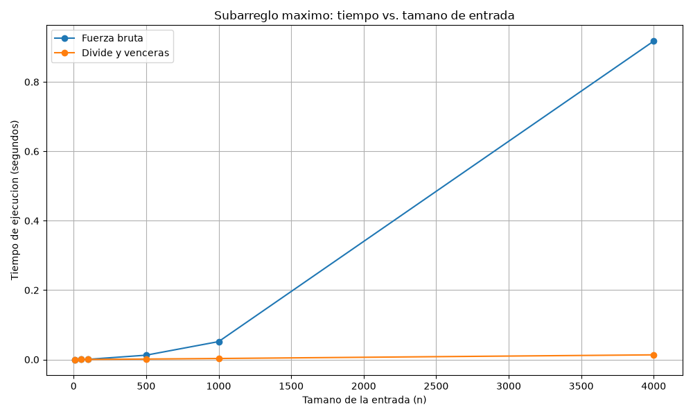

# Laboratorio evaluativo 02 — Dividir y vencer

**Estudiante:** Januar Stiwar Martinez Palacios  
**Asignatura:** Análisis de Algoritmos

## Instrucciones para reproducir el experimento

### Requisitos

- Python 3 instalado.
- Git para descargar el repositorio, si es necesario.
- La biblioteca `matplotlib` para generar la gráfica.

### Activar el entorno virtual

Desde la terminal de VS Code, ubicarse en la carpeta raíz del repositorio y ejecutar:

```powershell
python -m venv .venv
.\.venv\Scripts\Activate.ps1
```

Si el entorno virtual ya existe, solo es necesario activarlo. Después, instalar la dependencia:

```bash
pip install matplotlib
```

### Ejecutar las pruebas

```bash
python pruebas.py
```

El programa debe mostrar un mensaje indicando que todas las pruebas pasaron correctamente.

### Ejecutar las mediciones

```bash
python medicion.py
```

El programa mide los dos algoritmos, verifica que obtengan la misma suma máxima para cada tamaño y genera la gráfica en `graficas/tiempo_vs_n.png`.

## Parte 1 — Implementar y verificar las soluciones

**Código fuente:** [subarreglo.py](subarreglo.py) · [pruebas.py](pruebas.py)

Se implementaron dos soluciones para encontrar el subarreglo de mayor suma. La primera utiliza fuerza bruta y acumula la suma dentro de dos ciclos, evitando recalcularla desde cero para cada tramo. La segunda utiliza divide y vencerás, resolviendo los subproblemas izquierdo y derecho y comparándolos con el mejor tramo que cruza el punto medio.

Para verificar las soluciones, se realizaron pruebas con la serie de ocho días de la situación problema, una serie de un solo elemento, una serie con todos los valores negativos, una con todos los valores positivos y un caso en el que la mejor racha cruza el punto medio.

También se compararon las sumas máximas de ambos algoritmos en 100 listas aleatorias, generadas con una semilla fija. Las pruebas utilizan aserciones (`assert`) para comprobar los resultados. De esta manera, se verifica que ambas implementaciones encuentren la misma suma máxima en los casos evaluados.

## Parte 2 — Medir y graficar

**Código fuente:** [medicion.py](medicion.py)

El experimento se realizó con los tamaños de entrada 10, 50, 100, 500, 1000 y 4000. Los valores se generaron como enteros entre -100 y 100, utilizando la semilla fija 42. Para cada tamaño, ambos algoritmos recibieron exactamente la misma lista.

Se utilizó `time.perf_counter()` para medir únicamente el tiempo de ejecución de cada llamada. Cada medición se realizó una sola vez, sin repetir las ejecuciones ni calcular promedios. Por esta razón, los tiempos pueden variar según el equipo y las condiciones de ejecución.

La gráfica presenta ambas curvas en los mismos ejes, con título, etiquetas, unidades y leyenda.



### Resultados obtenidos

| Tamaño (n) | Fuerza bruta (s) | Divide y vencerás (s) | Suma máxima |
|---:|---:|---:|---:|
| 10 | 0.000031 | 0.000039 | 89 |
| 50 | 0.000163 | 0.000161 | 294 |
| 100 | 0.000582 | 0.000314 | 633 |
| 500 | 0.012562 | 0.001432 | 1181 |
| 1000 | 0.051687 | 0.002998 | 3382 |
| 4000 | 0.917631 | 0.013482 | 7311 |

## Parte 3 — Análisis

### 1. Recurrencia

La función `subarreglo_maximo` divide el arreglo en dos mitades, resuelve cada mitad de forma recursiva y encuentra la mejor suma que cruza el punto medio. Por tanto, su recurrencia es:

$$
T(n)=2T\left(\frac{n}{2}\right)+\Theta(n)
$$

El término $2T(n/2)$ corresponde a las dos llamadas recursivas, cada una con aproximadamente la mitad de los elementos. El término $\Theta(n)$ corresponde a `suma_cruzada`, que recorre los elementos desde el punto medio hacia ambos lados para encontrar la mejor suma que incluya elementos de las dos mitades. El caso base ocurre cuando el rango tiene un solo elemento y su costo es $\Theta(1)$.

Para resolver la recurrencia mediante el método maestro, se compara con la forma general:

$$
T(n)=aT\left(\frac{n}{b}\right)+f(n)
$$

En este caso, $a=2$, $b=2$ y $f(n)=\Theta(n)$. Entonces:

$$
n^{\log_b a}=n^{\log_2 2}=n
$$

Como $f(n)=\Theta(n^{\log_b a})$, se cumple la condición del caso 2 del método maestro. Por tanto:

$$
T(n)=\Theta(n\log n)
$$

La fuerza bruta tiene complejidad $\Theta(n^2)$. En su implementación, el primer ciclo selecciona los índices iniciales y el segundo recorre los posibles índices finales, acumulando la suma sin volver a empezar desde cero. El número de iteraciones del segundo ciclo, considerando todos los índices iniciales, es proporcional a:

$$
\sum_{i=0}^{n-1}(n-i)=\frac{n(n+1)}{2}
$$

El término dominante es cuadrático, por lo que el tiempo de ejecución pertenece a $\Theta(n^2)$.

### 2. Lo medido contra lo esperado

Los resultados muestran que la curva de fuerza bruta aumenta más rápidamente que la de divide y vencerás. Para comprobarlo, comparé los tiempos de los tamaños 500 y 1000, donde la entrada se duplica.

**Fuerza bruta:**

$$
\frac{0.051687}{0.012562}\approx 4.12
$$

El tiempo se multiplicó aproximadamente por 4.12. Esto se acerca al factor 4 esperado para un algoritmo de complejidad $\Theta(n^2)$ cuando se duplica el tamaño de entrada.

**Divide y vencerás:**

$$
\frac{0.002998}{0.001432}\approx 2.09
$$

Para un algoritmo de complejidad $\Theta(n\log n)$, el factor esperado al duplicar $n$ es:

$$
\frac{2n\log(2n)}{n\log n}
=2\,\frac{\log(2n)}{\log n}
$$

Para $n=500$, este factor es aproximadamente 2.22. La medición de 2.09 es cercana a lo esperado.

En conclusión, los resultados concuerdan con las complejidades teóricas: fuerza bruta presenta un crecimiento cuadrático, mientras que divide y vencerás crece aproximadamente de acuerdo con $n\log n$. Las pequeñas diferencias se pueden deber a que cada tiempo se midió una sola vez y a las condiciones del equipo.

### 3. Tamaños pequeños

Para $n=10$, fuerza bruta fue más rápida: tardó 0.000031 segundos, frente a 0.000039 segundos de divide y vencerás. En $n=50$, divide y vencerás comenzó a mostrar una pequeña ventaja, con 0.000161 segundos frente a 0.000163 segundos.

A partir de $n=100$, la diferencia fue más evidente. En ese tamaño, fuerza bruta tardó 0.000582 segundos y divide y vencerás 0.000314 segundos. Para $n=4000$, los tiempos fueron 0.917631 y 0.013482 segundos, respectivamente.

Esto muestra que, en las mediciones realizadas, divide y vencerás empieza a ganar desde $n=50$, aunque la diferencia inicial es muy pequeña. Para entradas reducidas, el costo de las llamadas recursivas puede compensar parte de su ventaja, y las variaciones propias de la medición también pueden influir.

### 4. ¿Cuándo conviene dividir?

Si el objetivo fuera encontrar el número máximo de un arreglo, recorrerlo una sola vez sería suficiente. Se compara cada elemento con el máximo encontrado hasta ese momento, lo que requiere tiempo $\Theta(n)$.

También se podría dividir el arreglo en dos mitades, encontrar el máximo de cada una y comparar ambos resultados. La recurrencia sería:

$$
T(n)=2T\left(\frac{n}{2}\right)+\Theta(1)
$$

En este caso, el costo de combinar es constante porque solo se comparan dos máximos. Aplicando el método maestro, $a=2$, $b=2$ y $f(n)=\Theta(1)$. Como $n^{\log_2 2}=n$, corresponde al caso 1 y se obtiene:

$$
T(n)=\Theta(n)
$$

Por tanto, dividir no mejora el orden de complejidad frente al recorrido lineal. Ambos métodos son $\Theta(n)$, pero el recorrido directo es más sencillo y evita la sobrecarga de las llamadas recursivas. En cambio, para encontrar el subarreglo de mayor suma, divide y vencerás permite mejorar de $\Theta(n^2)$ a $\Theta(n\log n)$.

### 5. Concepto para la gerente

Recomiendo utilizar divide y vencerás para encontrar la mejor racha de las tiendas, especialmente si se van a analizar series de cientos de miles o millones de registros.

En la medición con $n=4000$, fuerza bruta tardó 0.917631 segundos, mientras que divide y vencerás tardó 0.013482 segundos. En ese tamaño, el segundo algoritmo fue aproximadamente 68 veces más rápido.

Para estimar los tiempos con un millón de registros, utilizo los tiempos medidos para $n=4000$ y las complejidades teóricas de los algoritmos. Los siguientes valores son **estimaciones, no mediciones reales**.

**Fuerza bruta — $\Theta(n^2)$**

Suponiendo un crecimiento cuadrático:

$$
t(10^6)\approx 0.917631\left(\frac{10^6}{4000}\right)^2
$$

$$
t(10^6)\approx 57351.94\ \text{segundos}
$$

Esto equivale aproximadamente a 15.9 horas.

**Divide y vencerás — $\Theta(n\log n)$**

Suponiendo un crecimiento proporcional a $n\log n$:

$$
t(10^6)\approx 0.013482\cdot\frac{10^6\log_2(10^6)}{4000\log_2(4000)}
$$

$$
t(10^6)\approx 5.61\ \text{segundos}
$$

Estas estimaciones suponen que el comportamiento observado se mantiene al aumentar el tamaño de entrada. Los tiempos reales pueden variar según el equipo, el entorno de ejecución y otros factores.

En conclusión, para procesar un millón de registros, divide y vencerás sería considerablemente más conveniente. Según la estimación, podría encontrar la mejor racha en unos pocos segundos, mientras que fuerza bruta podría tardar varias horas. Esto permitiría analizar historiales más extensos de manera más eficiente.