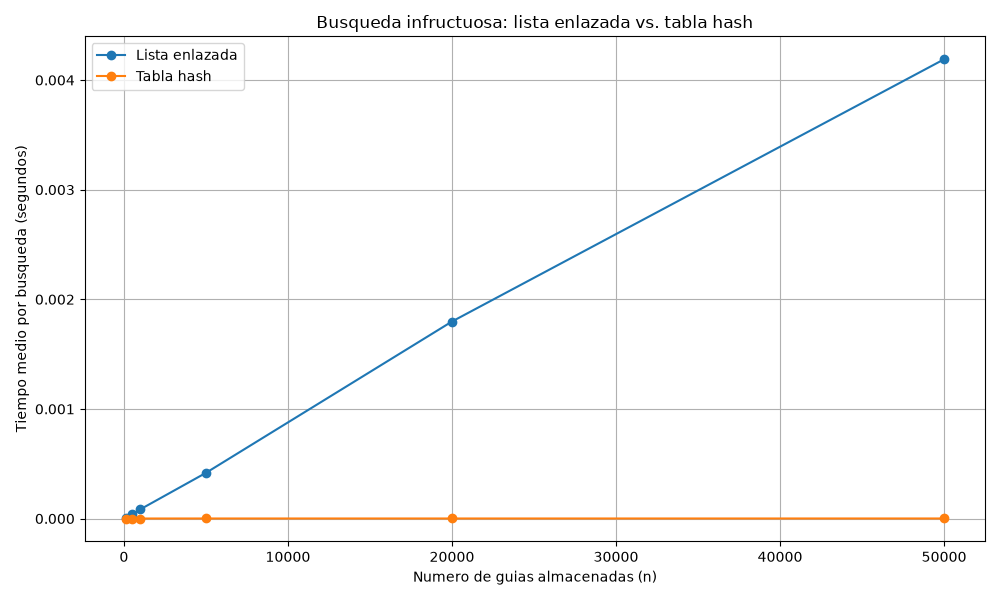
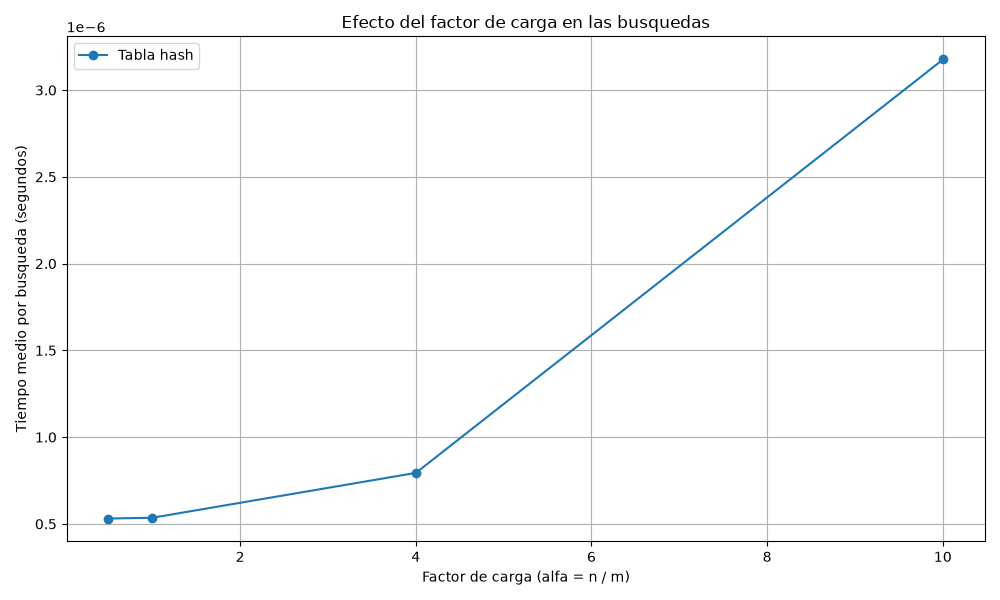

# Laboratorio evaluativo 03 — Estructuras de datos

**Estudiante:** Januar Stiwar Martinez Palacios  
**Asignatura:** Análisis de Algoritmos

## Instrucciones para reproducir el experimento

### Requisitos

- Python 3 instalado.
- Git para descargar el repositorio, si es necesario.
- La biblioteca `matplotlib` para generar las gráficas.

### Activar el entorno virtual

Desde la terminal de VS Code, ubicarse en la carpeta raíz del repositorio y ejecutar:

```powershell
python -m venv .venv
.\.venv\Scripts\Activate.ps1
```

Si el entorno virtual ya existe, solo es necesario activarlo. Después, instalar la dependencia:

```bash
pip install matplotlib
```

### Ejecutar las pruebas

```bash
python pruebas.py
```

El programa debe mostrar un mensaje indicando que todas las pruebas pasaron correctamente.

### Ejecutar las mediciones

```bash
python medicion.py
```

El programa realiza los dos experimentos, compara las estructuras y genera las gráficas en la carpeta `graficas`.

## Parte 1 — Implementar y verificar las dos estructuras

**Código fuente:** [estructuras.py](estructuras.py) · [pruebas.py](pruebas.py)

Se implementaron una lista enlazada y una tabla hash para consultar el estado de los envíos mediante su número de guía. La tabla hash utiliza el método de la división para calcular la casilla y reutiliza listas enlazadas para almacenar las guías que producen colisiones.

Para verificar el funcionamiento, se probaron búsquedas exitosas y búsquedas de guías inexistentes en ambas estructuras. También se verificó una colisión forzada con las guías 10, 24 y 17, utilizando una tabla de 7 casillas. Las tres guías deben quedar en la casilla 3.

Además, se comprobó que el factor de carga fuera correcto y se compararon los resultados de la lista y la tabla en al menos 20 colecciones aleatorias. Se utilizaron aserciones (`assert`) para detectar resultados incorrectos.

## Parte 2 — Medir y graficar

**Código fuente:** [medicion.py](medicion.py)

Se realizaron dos experimentos para comparar el tiempo de búsqueda de la lista enlazada y la tabla hash.

En el primer experimento se utilizaron seis tamaños de entrada, desde 100 hasta 50.000 guías. Para cada tamaño se construyeron las dos estructuras con los mismos datos. La tabla utilizó un número primo de casillas cercano a la mitad del número de guías, por lo que el factor de carga quedó aproximadamente en 2.

Se midieron 200 búsquedas de guías inexistentes por cada configuración. Se utilizó `time.perf_counter()` para medir el tiempo de búsqueda y se empleó una semilla fija para facilitar la reproducción del experimento.

### Gráfica 1. Lista enlazada frente a tabla hash



Los resultados obtenidos fueron los siguientes:

| Guías (n) | Casillas (m) | Factor de carga (α) | Lista enlazada (s) | Tabla hash (s) |
|---:|---:|---:|---:|---:|
| 100 | 47 | 2.128 | 0.00000846 | 0.00000051 |
| 500 | 251 | 1.992 | 0.00003886 | 0.00000049 |
| 1.000 | 499 | 2.004 | 0.00008445 | 0.00000070 |
| 5.000 | 2.503 | 1.998 | 0.00041699 | 0.00000093 |
| 20.000 | 10.007 | 1.999 | 0.00179751 | 0.00000090 |
| 50.000 | 24.989 | 2.001 | 0.00418940 | 0.00000099 |

En el segundo experimento se mantuvo fijo el número de guías en 20.000 y se modificó el número de casillas para obtener cuatro factores de carga diferentes. Se midieron nuevamente 200 búsquedas inexistentes por configuración.

### Gráfica 2. Tiempo de búsqueda según el factor de carga



Los resultados fueron:

| Guías (n) | Casillas (m) | Factor de carga (α) | Tabla hash (s) |
|---:|---:|---:|---:|
| 20.000 | 40.009 | 0.500 | 0.00000053 |
| 20.000 | 19.997 | 1.000 | 0.00000054 |
| 20.000 | 4.999 | 4.001 | 0.00000079 |
| 20.000 | 1.999 | 10.005 | 0.00000318 |

Los tiempos corresponden a las mediciones obtenidas durante la ejecución del programa. Debido a que las búsquedas son muy rápidas, pequeñas variaciones del equipo y del entorno pueden afectar los resultados.

## Parte 3 — Análisis

### 1. Costo teórico

En la lista enlazada, para buscar una guía que no existe es necesario recorrer todos los nodos, porque no se sabe en qué posición podría estar. Por eso, si hay `n` guías, el tiempo de búsqueda crece proporcionalmente al número de elementos.

$$
T(n)=\Theta(n)
$$

En la tabla hash, primero se calcula la casilla correspondiente a la guía y después se busca en la lista enlazada de esa casilla. Si la función hash distribuye las claves de manera aproximadamente uniforme, el número esperado de elementos por casilla depende del factor de carga:

$$
\alpha=\frac{n}{m}
$$

Por eso, el costo promedio de una búsqueda con encadenamiento se expresa como:

$$
T(n)=\Theta(1+\alpha)
$$

Cuando el factor de carga se mantiene controlado, el tiempo promedio de búsqueda puede mantenerse cercano a constante. Sin embargo, si todas las claves caen en la misma casilla, la lista de esa casilla puede contener los `n` elementos. En ese caso, la búsqueda vuelve a tener un costo de Θ(n), porque se deben recorrer muchos nodos.

### 2. Lo medido contra lo esperado

En la primera gráfica, el tiempo de la lista enlazada aumenta cuando crece el número de guías. Por ejemplo, al pasar de 100 a 500 guías, el tamaño aumenta cinco veces. El factor de crecimiento medido para la lista es:

$$
\frac{0.00003886}{0.00000846}\approx 4.59
$$

Este resultado se aproxima al crecimiento lineal esperado, aunque no es exactamente cinco debido a las variaciones de las mediciones.

Para la tabla hash, en los mismos tamaños, el factor de crecimiento es:

$$
\frac{0.00000049}{0.00000051}\approx 0.96
$$

El tiempo medido prácticamente no cambió. Esto concuerda con el comportamiento esperado de Θ(1 + α), ya que el factor de carga se mantuvo cerca de 2.

También se puede comparar el crecimiento entre 20.000 y 50.000 guías. Para la lista enlazada:

$$
\frac{0.00418940}{0.00179751}\approx 2.33
$$

El número de guías aumentó 2,5 veces y el tiempo de búsqueda aumentó aproximadamente 2,33 veces, lo cual se acerca al crecimiento lineal.

Para la tabla hash:

$$
\frac{0.00000099}{0.00000090}\approx 1.10
$$

El tiempo aumentó aproximadamente 1,10 veces, aunque el número de guías aumentó 2,5 veces. Esto es consistente con el costo promedio esperado cuando el factor de carga se mantiene aproximadamente constante.

En la segunda gráfica, el tiempo de búsqueda de la tabla hash aumenta al incrementar el factor de carga. Para α cercano a 0,5 y 1, los tiempos fueron muy similares. Cuando α llegó aproximadamente a 10, el tiempo aumentó a 0,00000318 segundos. Esto muestra que, al tener más guías por casilla, puede ser necesario recorrer listas más largas.

Los resultados concuerdan en general con la teoría, pero las mediciones no tienen que coincidir exactamente con los factores esperados, especialmente cuando los tiempos son tan pequeños.

### 3. Colisiones.

Una colisión ocurre cuando dos o más guías producen el mismo índice al aplicar la función hash. Por ejemplo, al usar una tabla de siete casillas:

$$
10\bmod 7=3
$$

$$
24\bmod 7=3
$$

$$
17\bmod 7=3
$$

Las tres guías deben almacenarse en la casilla 3. En nuestra implementación se utiliza **encadenamiento**, es decir, cada casilla contiene una lista enlazada que almacena todas las guías que llegan a ella. Su ventaja es que permite manejar las colisiones agregando nodos a la lista. Su desventaja es que, cuando hay muchas colisiones, la búsqueda debe recorrer más elementos.

En cambio, el **direccionamiento abierto** almacena todos los elementos directamente en el arreglo de la tabla. Cuando una casilla está ocupada, busca otra posición disponible mediante una estrategia como el sondeo lineal o el sondeo cuadrático. No necesita listas enlazadas adicionales, pero puede requerir varias comprobaciones para encontrar una posición libre o localizar una guía, especialmente cuando la tabla está muy ocupada.

### 4. Tabla hash o árbol de búsqueda

La tabla hash está diseñada para encontrar una guía específica, no para recuperar todas las guías comprendidas entre dos valores. Esto se debe a que la función hash distribuye las claves según su índice calculado y no conserva el orden numérico de las guías.

Para consultar un rango, como todas las guías entre 100.000 y 200.000, sería necesario revisar las casillas y comprobar cuáles contienen claves dentro del intervalo. Por eso, para este tipo de consulta conviene utilizar un árbol binario de búsqueda equilibrado, que mantiene las claves ordenadas y permite recorrer únicamente las ramas relevantes.

Si se insertan 400.000 guías en orden ascendente en un árbol binario de búsqueda normal, el árbol puede degenerarse en una estructura parecida a una lista enlazada. En el peor caso, su altura tendría aproximadamente 399.999 aristas y una búsqueda podría necesitar cerca de 400.000 comparaciones.

En cambio, si el árbol se mantiene equilibrado, su altura es proporcional al logaritmo del número de elementos. Como referencia:

$$
\log_2(400000)\approx 18.61
$$

Por tanto, la altura de un árbol equilibrado sería del orden de 19 aristas y una búsqueda podría requerir alrededor de 20 comparaciones, dependiendo de la estructura y de la posición de la clave. Esto es mucho más eficiente que recorrer un árbol degenerado.

### 5. Concepto para la jefa de operaciones

Recomendaría utilizar una tabla hash para las búsquedas puntuales por número de guía, porque en las mediciones fue mucho más rápida que la lista enlazada. Si también se necesitan consultas por rangos, utilizaría adicionalmente un árbol de búsqueda equilibrado, ya que permite consultar las guías conservando su orden.

Para estimar el tiempo de búsqueda con cinco millones de guías, se puede tomar como referencia la medición de 50.000 guías. En la lista enlazada se obtuvo un tiempo de 0,00418940 segundos. Si el crecimiento fuera lineal, el tiempo estimado para una búsqueda sería:

$$
t(5\,000\,000)\approx
0.00418940\cdot\frac{5\,000\,000}{50\,000}
$$

$$
t(5\,000\,000)\approx 0.419\text{ segundos}
$$

Para la tabla hash, la medición con 50.000 guías y un factor de carga cercano a 2 fue de 0,00000099 segundos por búsqueda. Si se mantiene un factor de carga parecido y una distribución uniforme de las claves, el tiempo promedio podría mantenerse del mismo orden de magnitud, alrededor de una millonésima de segundo por búsqueda.

En conclusión, la tabla hash sería la opción principal para consultar envíos por una guía específica. Si el sistema necesita buscar por intervalos de guías, combinarla con un árbol de búsqueda equilibrado permitiría atender ambos tipos de consulta de manera más eficiente.
